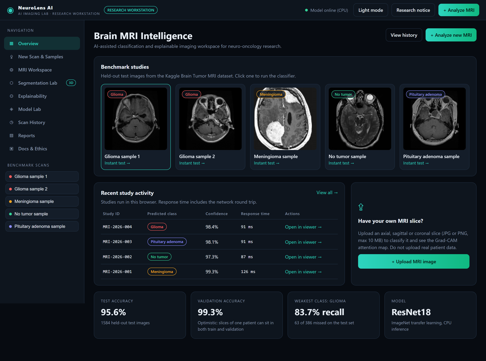
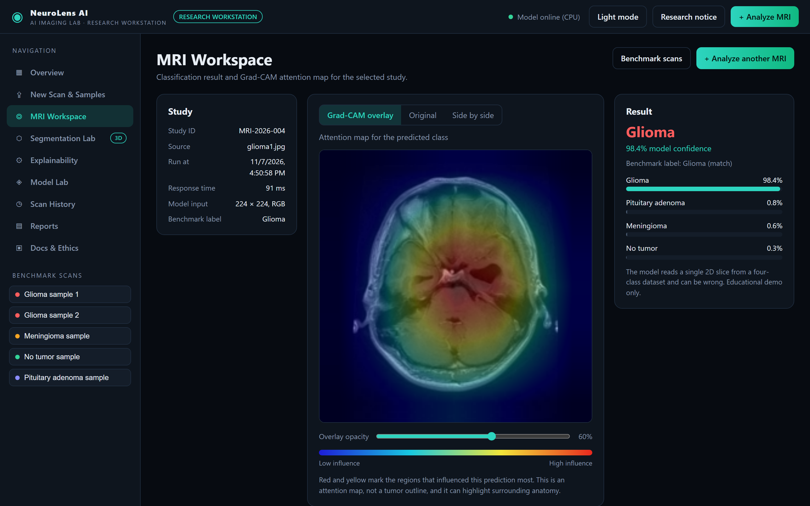
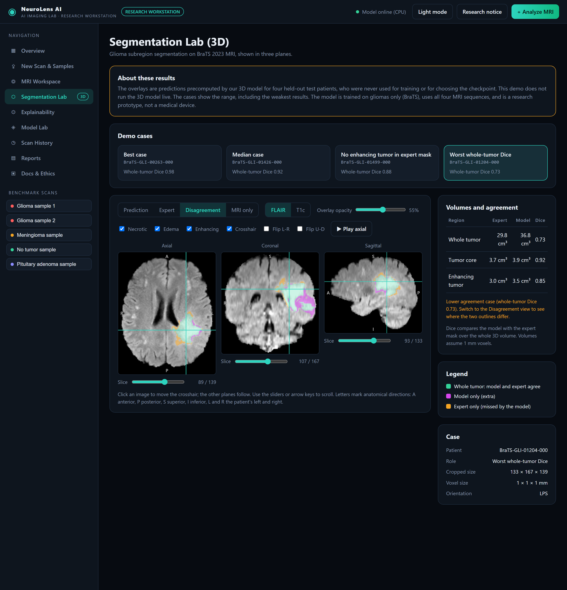
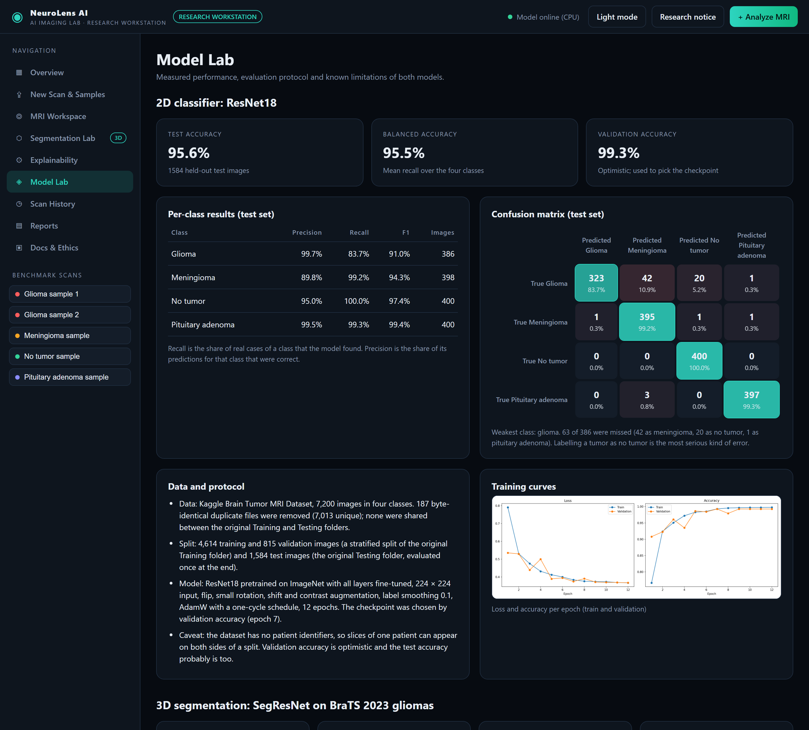

# NeuroLens AI

[](https://neurolens-ai-gold.vercel.app/)
[](https://github.com/Harris-Majeed/neurolens-ai)
[](https://pytorch.org/)
[](https://monai.io/)
[](https://fastapi.tiangolo.com/)
[](docs/metrics_2d.json)
[](tests/)

> **Live preview:** [https://neurolens-ai-gold.vercel.app/](https://neurolens-ai-gold.vercel.app/)  
> The hosted page is a static preview: the benchmark scans, Grad-CAM maps, Segmentation Lab and Model Lab show results precomputed from the real models. To analyze your own scans, [run it locally](#run-it-locally).

**Brain MRI classification, explainable attention maps, and 3D glioma segmentation in one research workstation.**

A student research project that combines a 2D tumor classifier (ResNet18 with Grad-CAM) and a 3D glioma segmentation model (MONAI SegResNet) in a web interface, with the measured results and the weaknesses of both models shown openly.

> ⚠️ **Research and education only.** This is not a medical device. It has not been reviewed by any regulator and must not be used for diagnosis, treatment decisions or patient management. Do not upload real patient data.

| Overview | MRI Workspace |
|---|---|
|  |  |
| **Segmentation Lab** | **Model Lab** |
|  |  |

## What it does

- **2D classification:** upload a brain MRI slice (JPG or PNG) and get one of four classes (glioma, meningioma, pituitary adenoma, no tumor) with class probabilities. Typical response time is under 0.2 s on a laptop CPU.
- **Grad-CAM attention maps:** shows where the model looked. It is an attention map, not a tumor outline, and the interface says so.
- **3D segmentation lab:** axial, coronal and sagittal views of four held-out BraTS test patients with the model's glioma subregions, the expert outline, a disagreement view, FLAIR/T1c switching, a crosshair, tumor volumes and Dice per region. The lab shows precomputed predictions and does not run the 3D model live.
- **Model Lab:** measured accuracy, per-class metrics, confusion matrix, per-patient segmentation results, training setup and limitations, all read from the saved metrics files.
- **Explainability, Scan History, Reports, Docs & Ethics:** how to read Grad-CAM, a browser-only study history with CSV export, printable one-page reports, and the data and ethics notes.

## Results

All numbers come from held-out data that was not used for training or for choosing a checkpoint. They are a single training run on small test sets, so treat them with caution (see Limitations).

### 2D classifier (ResNet18, 1,584 test images)

| | Value |
|---|---|
| Test accuracy | **95.6%** |
| Balanced accuracy | 95.5% |
| Validation accuracy (used to pick the checkpoint) | 99.3% (optimistic) |

| Class | Precision | Recall | F1 | Images |
|---|---|---|---|---|
| Glioma | 99.7% | **83.7%** | 91.0% | 386 |
| Meningioma | 89.8% | 99.2% | 94.3% | 398 |
| No tumor | 95.0% | 100.0% | 97.4% | 400 |
| Pituitary adenoma | 99.5% | 99.3% | 99.4% | 400 |

The weak spot is glioma: 63 of 386 were missed (42 labelled meningioma, 20 labelled no tumor, 1 labelled pituitary). Labelling a tumor as "no tumor" is the most serious kind of error. In the four glioma-to-meningioma mistakes inspected with Grad-CAM, the attention sat on the visible mass, so the model found the lesion but chose the wrong type.

### 3D segmentation (SegResNet, 15 test patients)

| Region | Dice (mean) | Dice (worst patient) | IoU | Sensitivity | Precision | Volume correlation |
|---|---|---|---|---|---|---|
| Whole tumor | 0.908 | 0.734 | 0.838 | 0.938 | 0.885 | 0.987 |
| Tumor core | 0.903 | 0.574 | 0.836 | 0.949 | 0.881 | 0.911 |
| Enhancing tumor | 0.819 | 0.000 | 0.734 | 0.904 | 0.805 | 0.961 |

Mean Dice over the three regions is 0.876 (validation of the chosen checkpoint: 0.833). One test patient has no enhancing tumor in the expert mask while the model predicted a small amount, which scores 0 for that patient and lowers the enhancing-tumor average. The model tends to over-segment small tumors and swelling. Per-patient numbers are in `docs/seg_test_per_patient.csv`.

## How it was built

**2D classifier.** Kaggle Brain Tumor MRI Dataset (7,200 images). MD5 hashing found 187 byte-identical duplicates within single splits (7,013 unique) and none shared between the original Training and Testing folders. A stratified 85/15 split of the Training folder gave 4,614 training and 815 validation images, and the 1,584 test images were used once at the end. ResNet18 (ImageNet weights, all layers fine-tuned), 224 × 224 input, augmentation, label smoothing, AdamW with a one-cycle schedule, 12 epochs, checkpoint chosen on validation accuracy.

**3D segmentation.** BraTS 2023 adult glioma scans with four sequences (T1n, T1c, T2w, T2-FLAIR). A random 100 of the 1,133 patients were used and split by patient (70 / 15 / 15), because 118 patients have several scans. Volumes were cropped to the brain and each sequence was normalised inside the brain. MONAI SegResNet (4.7 million parameters) predicts the overlapping regions whole tumor, tumor core and enhancing tumor from 96³ patches (two thirds centred on tumor) with a Dice plus cross-entropy loss, AdamW, a cosine schedule and 120 epochs (about 85 minutes on a Colab T4). Whole-brain inference uses a sliding window.

**Evaluation habits worth noting.** Splits are by patient where patient identity is known, duplicates were removed before splitting, the test sets were touched once, and every figure quoted in the web interface is checked against the saved metrics files by the test suite.

## Run it locally

```bash
git clone https://github.com/Harris-Majeed/neurolens-ai.git
cd neurolens-ai
pip install -r requirements.txt
python run_server.py
```

Open http://127.0.0.1:8000. For a smaller CPU-only PyTorch install, run `pip install torch torchvision --index-url https://download.pytorch.org/whl/cpu` first.

Tested on Windows 11 (CPU only) with fastapi 0.162.0, uvicorn 0.54.0, pillow 11.1.0, numpy 2.1.3, matplotlib 3.10.0, torch 2.15.0+cpu and torchvision 0.29.2+cpu.

**Tests.** `pip install pytest httpx`, then `python -m pytest -v`. The suite covers the API, upload validation, the saved metrics and the figures quoted in the interface. The segmentation tests also need `pip install -r requirements-dev.txt` and one run of `python scripts/test_seg.py` to download a single BraTS test case. They are skipped when those are missing.

**Retraining.** The two notebooks in `notebooks/` were run in Google Colab on a T4 GPU. They expect the Kaggle dataset zip in Google Drive and download the BraTS subset from Hugging Face. The exact patient and image splits are saved in `docs/splits.json` and `docs/splits.csv`.

## Project structure

```
neurolens-ai/
├── backend/            FastAPI app (main.py), 2D inference with Grad-CAM (predict.py),
│                       demo and metrics routes (seg_api.py), 3D inference module (seg_infer.py)
├── frontend/           Plain HTML, CSS and JavaScript (no external libraries)
│   ├── js/, css/       Pages: overview, workspace, segmentation, model lab, history, reports, docs
│   ├── samples/        Five 2D benchmark images
│   ├── seg_demo/       Four precomputed segmentation demo cases
│   └── assets/         Chart images used by the Model Lab and Explainability pages
├── models/             Trained weights (ResNet18 and SegResNet)
├── docs/               Measured metrics (JSON, CSV) and data splits
├── notebooks/          Colab notebooks for both models
├── scripts/            Screenshot, notebook-scan and local test helpers
├── tests/              pytest suite
├── DATA_PROVENANCE.md  Where every dataset, file and checkpoint comes from
└── run_server.py       Starts the app
```

`seg_infer.py` can run the 3D model on a CPU (about 11 s per scan on an 8-thread laptop). The web app does not call it: it shows precomputed predictions, and the tests and `scripts/test_seg.py` use it.

## Limitations

- Research prototype. Not a medical device, and not for any clinical use.
- Small test sets (1,584 images; 15 patients) and a single training run, so small differences between numbers should not be over-read.
- The 2D dataset has no patient identifiers, so slices of one patient can sit on both sides of a split. Validation and test accuracy are probably optimistic.
- The 2D model has four fixed outcomes. It cannot recognise other conditions and will force any image into one of the four classes, often with high confidence. A missed tumor is its most serious error.
- Grad-CAM shows where the model looked, not where a tumor is. It is coarse (a 7 × 7 grid) and can highlight surrounding anatomy.
- The segmentation model was trained on 100 patients of one dataset, on gliomas only, with skull-stripped, co-registered 1 mm BraTS-style volumes. The demo shows four precomputed test patients. It is not comparable with BraTS challenge leaderboards.
- Patient age, sex, scanner and site were not available, so subgroup performance is unknown.

## Data, licenses and credits

- **2D data:** *Brain Tumor MRI Dataset* by Masoud Nickparvar on Kaggle, licensed CC BY 4.0. The dataset page lists its own original sources, which carry their own terms.
- **3D data:** BraTS 2023 adult glioma challenge data, read from the Hugging Face copy `MedOtter/brats2023-gli-dataset` (CC-BY-4.0 as listed there; original distribution on Synapse, `syn51156910`). The repository contains four BraTS-derived demo cases (images and masks derived from BraTS scans) and weights trained on that data. Check the dataset terms before redistributing them.
- **Code:** MIT License (see `LICENSE`). The license covers the code only, not the datasets or anything derived from them.
- **References:** Baid et al., *The RSNA-ASNR-MICCAI BraTS 2021 benchmark on brain tumor segmentation and radiogenomic classification* (2021); Menze et al., *The multimodal brain tumor image segmentation benchmark (BRATS)*, IEEE TMI 2015; He et al., *Deep residual learning for image recognition*, CVPR 2016; Selvaraju et al., *Grad-CAM*, ICCV 2017; Myronenko, *3D MRI brain tumor segmentation using autoencoder regularization*, 2018.
- Built with PyTorch, torchvision, MONAI, nibabel and FastAPI. Full provenance details are in [DATA_PROVENANCE.md](DATA_PROVENANCE.md).

## Author

**Haris Majeed**, AI Engineer & Data Scientist

[LinkedIn](https://www.linkedin.com/in/haris-majeed-896550203/) · [GitHub](https://github.com/Harris-Majeed) · [Portfolio](https://haris-majeed.vercel.app/)
